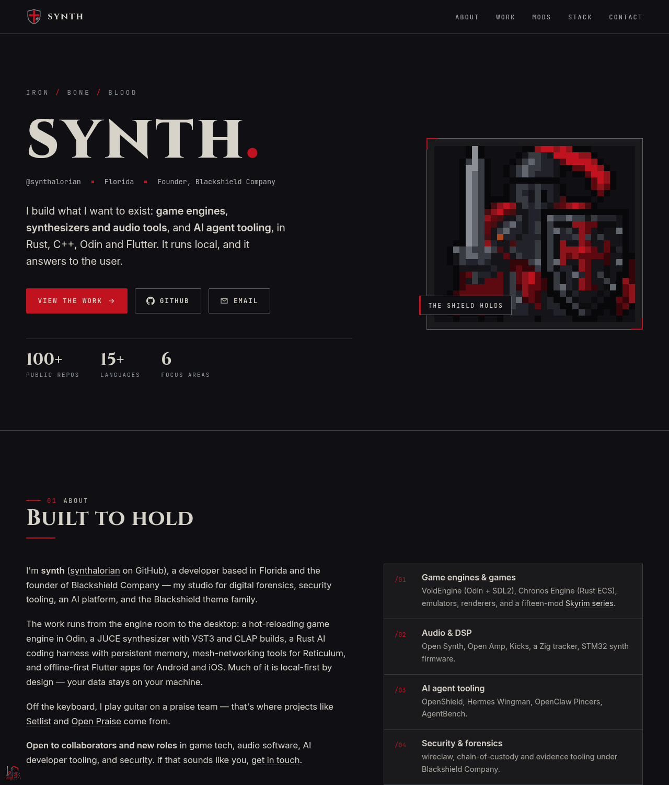

# synth: portfolio

Personal portfolio for **synth** ([@synthalorian](https://github.com/synthalorian)). Blackshield livery: matte black, blood red, steel and bone, with the Blackshield knight as the mascot.
Plain static files: HTML, CSS, a little vanilla JS. No build step, no frameworks, no trackers, no runtime API calls.

## Structure

```
index.html              the whole site (all project data is hardcoded here)
404.html                not-found page
favicon.svg, favicon-32.png, favicon.ico, apple-touch-icon.png, icon-512.png   knight icons
assets/css/blackshield.css   palette variables (black #101014, blood #C1121F, steel #8F959C, bone #D8D3C8)
assets/css/knight.css        the knight sprite player (32x28 frames, stepped by CSS)
assets/css/style.css         all site styles
assets/js/main.js       mobile nav, section highlight, scroll reveal, "More work" expand/collapse
assets/js/sprite.js     the corner knight (idle; a press plays the next move)
assets/fonts/           self-hosted Cinzel, Inter and JetBrains Mono (SIL OFL, licences included)
assets/img/knight/      canonical knight sprite strips and stills
assets/img/og-synthalorian.png   Open Graph card (1200x630)
assets/img/mods/        Skyrim mod cover thumbnails (640x360, WebP + JPEG fallback)
_headers                Cloudflare Pages security and cache headers
robots.txt, sitemap.xml
```

## Run locally

```sh
python3 -m http.server 8000
# open http://localhost:8000
```

Paths are root-relative (`/assets/...`), so serve from the repo root and don't open the file directly.

## Editing projects

Everything lives in `index.html`:

- **Featured projects**: the six `<article class="card panel">` blocks under `<section id="work">`. A seventh, full-width card (`#project-void-mercs-demo`) features the Void Mercs free demo; it reuses the `mod-card is-lead` layout with a 640×360 thumbnail in `assets/img/projects/` (WebP + JPEG, lazy-loaded). To swap one, copy a card and
  edit the title, repo link, description, three bullet points, tags, and the meta line (language · stars · version or date).
  Each card has an `id` (e.g. `#project-voidengine`) so you can deep-link to it.
- **More work**: the `<details class="work-group">` blocks. Each repo is one line:
  ```html
  <li><a href="https://github.com/synthalorian/REPO">REPO</a><span class="w-desc">One-line description.</span><span class="w-lang">Rust</span></li>
  ```
  Update the number in `<span class="wg-count">` and the "N more public repositories" line if you add or remove entries.
- **Skyrim mods**: `<section id="mods">`. A spec panel, then three waves of five `<article class="card panel mod-card">` cards. The
  first card of each wave has `is-lead` (spans two columns, art beside the text, three bullet points). Each card links to its Nexus
  page and GitHub repo. Thumbnails live in `assets/img/mods/<repo>.webp` and `.jpg`, 640×360, lazy-loaded. Cards say "early beta"
  instead of a version number on purpose, so they don't go stale when a mod is updated. The mod repos are not repeated in "More work".
- **Stack**: language bars use `style="--w:NN%"` (relative to the largest count); chips and domains are plain lists.
- **Contact**: the `contact-links` list near the bottom.

Data came from public GitHub metadata and READMEs as of October 2026. Star counts and versions are static. Update them by hand when you want to.

## Motion

Motion is limited to a short fade-and-rise when sections scroll into view and the knight's stepped sprite animation. Both are off under `prefers-reduced-motion` (the knight shows a still frame). `assets/js/main.js` adds the reveal only when the `js` class is set in `<head>`, which never happens for reduced motion.
